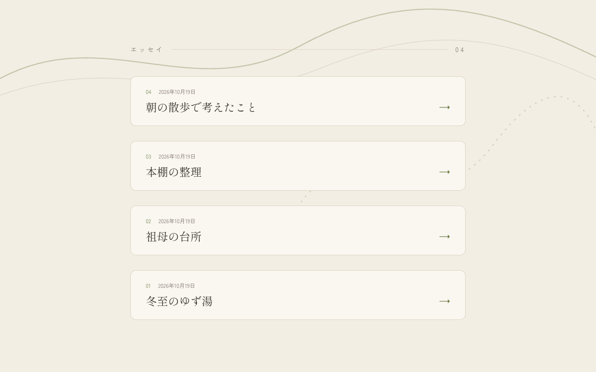
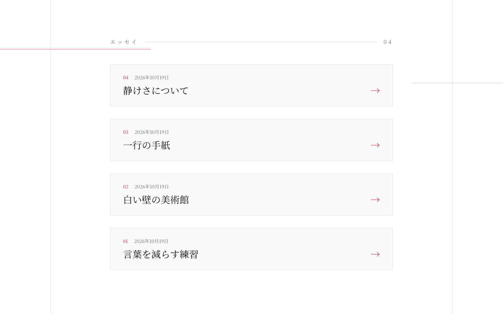
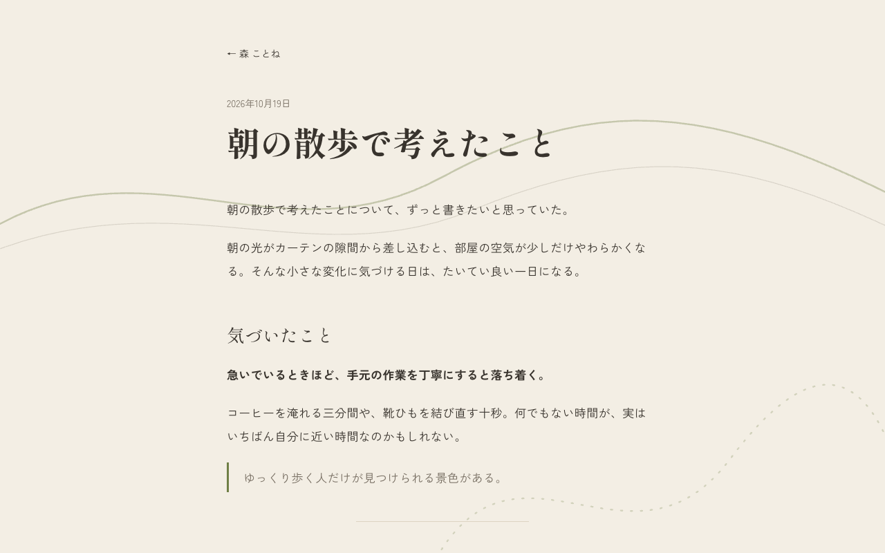
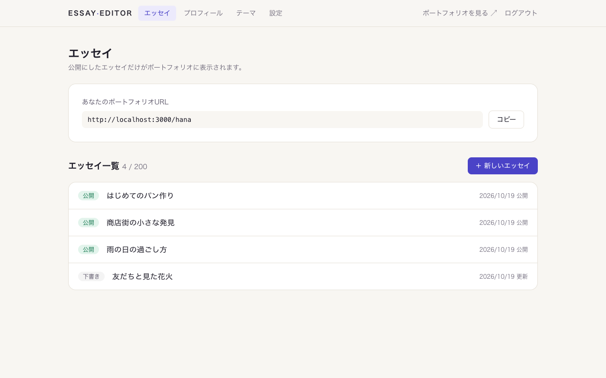
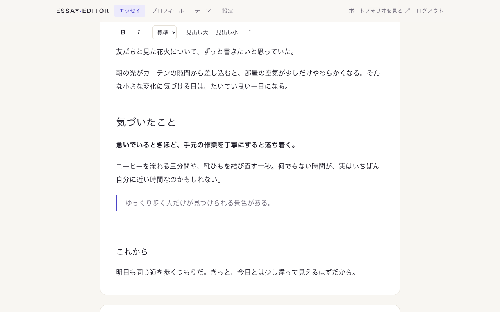
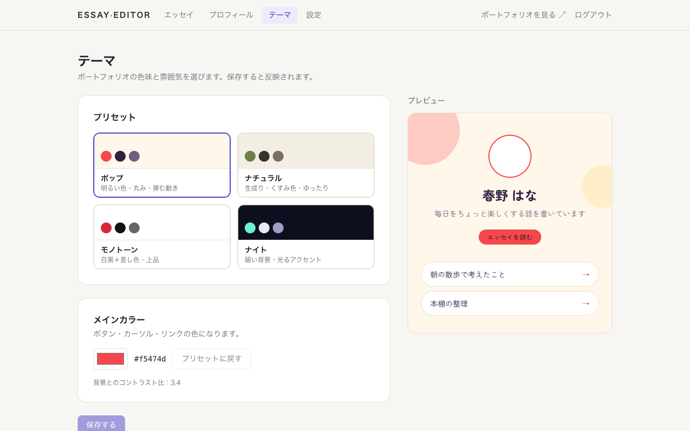

# Essay Portfolio

エッセイを、自分らしいデザインで公開できるポートフォリオサービスです。
**編集サイト**（書く・設定する）と **ポートフォリオサイト**（見せる）の2つの Next.js アプリで構成しています。
URL を渡すだけで誰でも登録でき、ユーザーごとに自分専用のポートフォリオ（`/<ユーザー名>`）を持てます。

> スクリーンショットは、ローカルの Firebase Emulator に架空のサンプルデータを入れて撮影したものです（顔写真は未設定）。

## スクリーンショット

### ポートフォリオサイト

テーマは4種類のプリセットから選び、メインカラーを微調整できます。

| ポップ | ナイト |
| --- | --- |
|  |  |

| ナチュラル（題名一覧） | モノトーン（題名一覧） |
| --- | --- |
|  |  |

| エッセイ詳細 | スマホ表示 |
| --- | --- |
|  |  |

### 編集サイト

| エッセイ一覧 | エッセイエディタ |
| --- | --- |
|  |  |

| テーマ設定（プレビュー付き） |
| --- |
|  |

## 主な機能

**編集サイト**（ログイン必須・検索エンジンには載せない）
- メール＋パスワード / Google で登録・ログイン（メール確認必須）、パスワード再設定
- ユーザー名（＝ポートフォリオの URL）の登録。重複・予約語はチェック
- プロフィール：顔写真（Cloudinary に署名付きアップロード）・名前・ひとことコメント
- テーマ：4種類のプリセット＋メインカラー微調整、即時プレビュー、コントラスト不足の警告
- エッセイエディタ：太字・斜体・文字サイズ・見出し・引用・区切り線、自動保存、離脱時の警告、下書き / 公開
- アカウント設定：表示言語（日本語 / 英語）、パスワード変更、退会（全データ削除）

**ポートフォリオサイト**（閲覧専用）
- 名前・顔写真・コメントがふわっと登場するファーストビュー
- スクロールで題名が浮かび上がる一覧、背景図形のパララックス
- マグネティックボタン（カーソルに引き寄せられる）とカスタムカーソル
- ページ切り替えアニメーション、テーマに合わせた 404 ページ
- エッセイごとの OGP 画像（題名入り）を自動生成
- スマホではカーソル演出の代わりにタップ反応、OS の「視差効果を減らす」設定に対応

## 技術スタック

| 区分 | 採用技術 | 用途 |
| --- | --- | --- |
| モノレポ管理 | pnpm workspaces ＋ Turborepo | 2アプリと共通パッケージを1リポジトリで管理 |
| フレームワーク | Next.js 16（App Router）＋ React 19 ＋ TypeScript | 両アプリ共通 |
| スタイル | Tailwind CSS 4 ＋ CSS 変数 | テーマ切替は CSS 変数で実現 |
| アニメーション | Framer Motion ＋ CSS アニメーション | カーソル追従・スクロール演出・登場演出 |
| リッチテキスト | Tiptap 3 | エディタ。本文は Tiptap JSON で保存し、React 要素として描画 |
| 認証 | Firebase Authentication | メール / パスワード ＋ Google ログイン |
| データベース | Cloud Firestore | セキュリティルールで本人以外の書き込みを拒否 |
| サーバー側検証 | firebase-admin | 編集サイトの API でのみ使用（ID トークン確認・退会処理） |
| 画像 | Cloudinary | 署名付きアップロード、URL 指定で正方形トリミング・最適化 |
| 多言語 | next-intl | 画面の文言を日本語・英語で切替 |
| テスト | Vitest ＋ @firebase/rules-unit-testing ＋ Firebase Emulator | セキュリティルールのテスト |
| ホスティング | Vercel（2プロジェクト） | Root Directory をそれぞれ `apps/editor`・`apps/portfolio` に設定 |

## ディレクトリ構成

```
.
├─ apps/
│  ├─ editor/       編集サイト（ログイン必須・書き込みはここだけ）
│  └─ portfolio/    ポートフォリオサイト（閲覧専用）
├─ packages/
│  ├─ shared/       型定義・テーマプリセット・入力チェック・翻訳ファイル
│  └─ ui/           エッセイ本文の表示部品など共通 UI
├─ firebase/        Firestore セキュリティルールとそのテスト
└─ docs/            要件定義書・セットアップ手順・スクリーンショット
```

## セキュリティの考え方

「他人のデータを編集できない」「ポートフォリオサイトから編集できない」を、コード・鍵・DB ルールの3層で守っています。

- **DB ルール**：書き込めるのは「ログイン済み・メール確認済みの本人」だけ。文字数・値の形式・エッセイ件数（200件まで）もルールで検査
- **鍵**：firebase-admin と Cloudinary の秘密鍵は編集サイトのサーバー側だけで使用。ポートフォリオには置かない
- **コード**：ポートフォリオは公開データの読み取りのみ。本文は生の HTML を埋め込まずに描画（スクリプト混入対策）

## ローカルで動かす

必要なもの：Node.js、pnpm、Java 21（Firebase Emulator 用）

```
pnpm install
```

```
pnpm emulators
```

```
pnpm dev
```

- 編集サイト：http://localhost:3001
- ポートフォリオ：http://localhost:3000

環境変数の設定や本番公開の手順は [docs/setup.md](docs/setup.md) を参照してください。
セキュリティルールのテストは `pnpm test:rules` で実行できます。

## ドキュメント

- [要件定義書](docs/requirements.md)
- [セットアップ手順](docs/setup.md)
